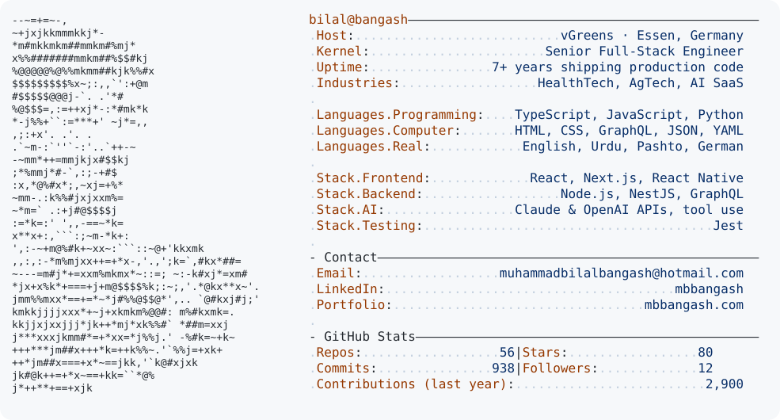
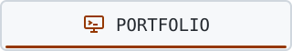
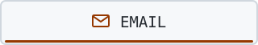

<a href="https://github.com/Bilal-Bangash">
  <picture>
    <source media="(prefers-color-scheme: dark)" srcset="dark_mode.svg">
    
  </picture>
</a>

  <a href="https://mbbangash.com"><picture><source media="(prefers-color-scheme: dark)" srcset="assets/portfolio-dark.svg"></picture></a>
  <a href="https://www.linkedin.com/in/mbbangash/"><picture><source media="(prefers-color-scheme: dark)" srcset="assets/linkedin-dark.svg"></picture></a>
  <a href="mailto:muhammadbilalbangash@hotmail.com"><picture><source media="(prefers-color-scheme: dark)" srcset="assets/email-dark.svg"></picture></a>

